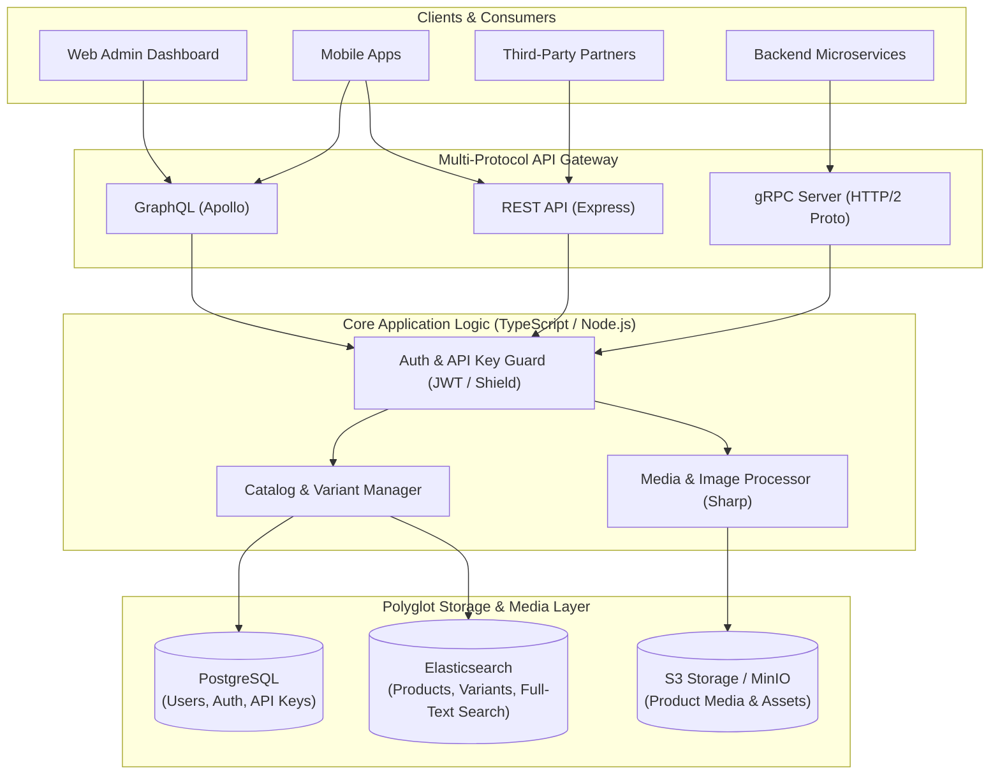
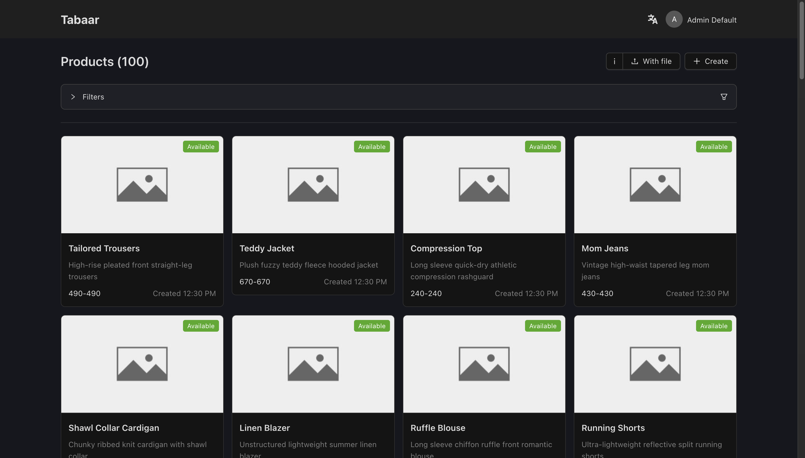

# Tabaar — Open-Source Product Management Service

**Tabaar** is a modern, high-performance, open-source Product Information and Catalog Management (PIM) service designed to serve high-throughput e-commerce and multi-channel applications. Built from the ground up to support modern distributed systems, Tabaar simultaneously exposes **REST**, **GraphQL**, and **gRPC** interfaces powered by a hybrid **PostgreSQL** + **Elasticsearch** data architecture and **S3-compatible** media storage.

---

## 🌟 Executive Summary

In contemporary e-commerce and microservices architectures, different clients require different communication paradigms: mobile apps crave lightweight REST/GraphQL endpoints, web dashboards demand flexible GraphQL queries, and internal microservices need high-speed, low-latency gRPC RPCs.

**Tabaar** unifies product catalog management into a single, cohesive engine. Instead of forcing teams to pick one API style or maintain brittle adapter layers, Tabaar delivers **all three protocols concurrently from a single core**, backed by dedicated storage engines optimized for both transactional integrity and sub-millisecond search at scale.

---

## 🚀 Key Features

### 1. Multi-Protocol Engine (REST, GraphQL & gRPC Concurrently)

Tabaar eliminates API trade-offs by providing native, concurrent support for all three major API standards out of the box:

- **RESTful API**: Standardized JSON endpoints with Swagger/OpenAPI specifications for easy third-party integrations, webhooks, and traditional HTTP clients.
- **GraphQL (Apollo Server)**: Declarative, flexible queries and mutations with field-level resolution, query pruning, and GraphQL Shield authorization—enabling frontends to fetch only the data they need.
- **gRPC (Protocol Buffers)**: High-efficiency, binary-serialized, HTTP/2 RPCs designed for internal microservice-to-microservice communication, bulk operations, and high-throughput ingestion pipelines.

### 2. Hybrid Data Architecture: Elasticsearch + PostgreSQL

Tabaar employs a polyglot persistence model where each database handles what it does best:

- **PostgreSQL (via Prisma ORM)**: Provides ACID-compliant transactional persistence for critical core models, authentication, user accounts, and API key management with deterministic audit trails.
- **Elasticsearch**: Acts as the dedicated high-performance search engine for product catalogs, multi-attribute variants, faceted filtering, price/spec ranges, and full-text fuzzy search across massive inventories.

### 3. S3-Compatible Object Storage

- Seamlessly integrates with **Amazon S3**, **MinIO**, or any S3-compliant object store.
- Built-in media pipeline handling product images, variant assets, and file uploads.
- Automated media optimization and thumbnail generation powered by Sharp before persisting to object buckets.

---

## 🏗️ Architecture Overview



---

## 🎯 Primary Use Cases

| Use Case                           | Description                                                                                                                  |
| :--------------------------------- | :--------------------------------------------------------------------------------------------------------------------------- |
| **Omnichannel E-Commerce**         | Centralize product catalog, variants, pricing, and assets across web, mobile, in-store POS, and partner marketplaces.        |
| **Microservices Catalog Backbone** | Serve internal ordering and inventory services over gRPC while exposing GraphQL to client applications.                      |
| **High-Faceted Search Catalogs**   | Deliver fast, complex attribute filtering (e.g., brand, price ranges, technical specs, categories) powered by Elasticsearch. |
| **Digital Asset Management (DAM)** | Store and link high-resolution product photography and assets reliably via S3-compatible storage.                            |

---

## 💻 Tech Stack Summary

- **Runtime & Language**: Node.js, TypeScript
- **APIs**: Apollo Server (GraphQL), Express 5 (REST), `@grpc/grpc-js` (gRPC)
- **Databases**: PostgreSQL (Prisma ORM), Elasticsearch 9
- **Asset Storage**: MinIO / AWS S3 SDK, Sharp
- **Validation & Security**: Zod schemas, GraphQL Shield, JWT authentication, UUIDv7 API keys

## Quick start

1. Clone the repository.
2. Configure .env file.
3. Install dependencies:

```bash
npm install
```

4. Start the Servers:

```bash
npm run dev
```

## Build script

```bash
npm run build
```

## Deploy script

```bash
npm run delpoy
```

## Deploy with Docker

[Quick start docker guide with new DB](docker-examples/README.md)

1. Copy or create [compose](docker-compose.yml) file.
2. Configurate [.env](.env.example) file with you existing DB and S3 connections.
3. Hit commad:

```bash
docker compose up -d
```

## Dashboard

Tabaar provides dashboard. Check [this](https://github.com/blnaxblachbl/tabaar-dashboard) repo to get started.


